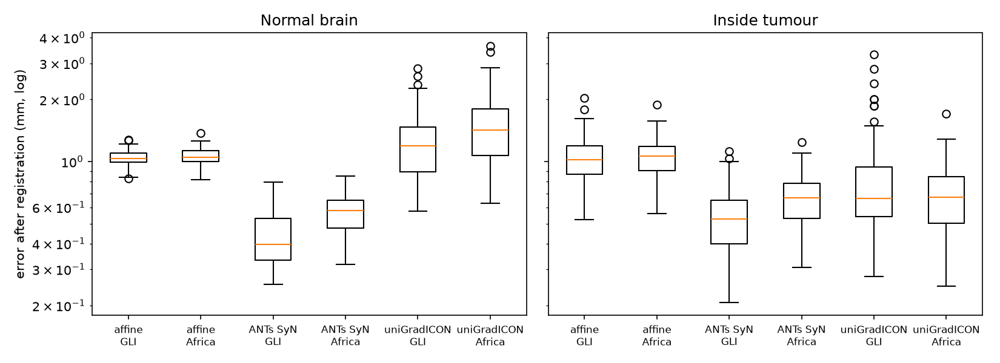
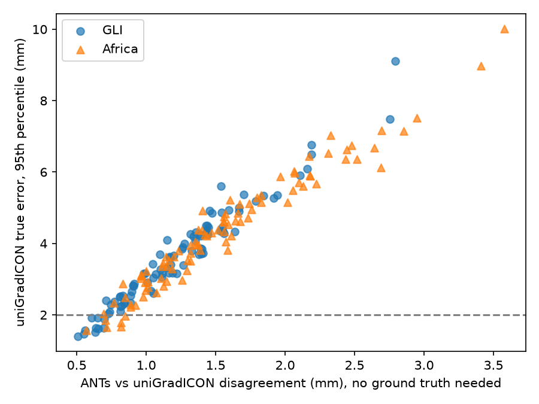
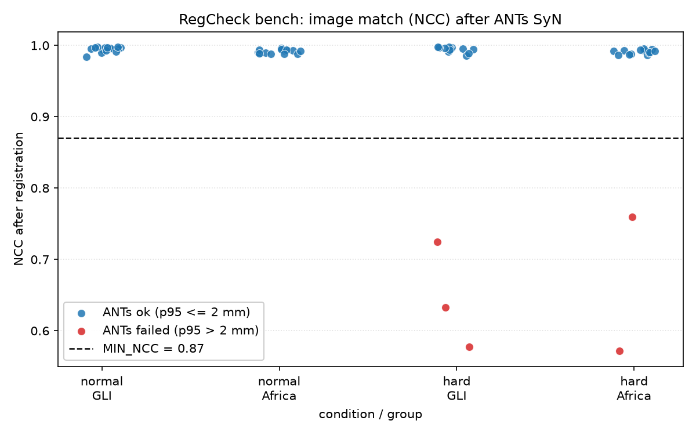

# Brain registration in the real world

Does image registration still work on BraTS-Africa scans, and can a simple tool flag registrations that failed?

## Why this matters

Registration means aligning two scans so the same anatomy sits at the same place in both. It is a hidden step in almost every neuroimaging pipeline: before you can compare two time points, pool scans across a study, or map a scan onto an atlas, you first register them.

A recent paper, *Domain-Shift Immunity in Deep Deformable Registration via Local Feature Representations* ([arXiv:2512.23142](https://arxiv.org/abs/2512.23142)), argues that deep registration models are largely immune to domain shift, because they estimate deformation from local features rather than global appearance. But that work tested synthetic or natural-image shifts in 2D, not a real change of scanner and patient population, and not brains with tumours.

BraTS-Africa provides MRI from a Sub-Saharan African population, which differs from the mostly North-American and European scans in the main BraTS set. That lets me test the claim on real clinical data, and then build a small tool that tries to catch registrations that went wrong.

## What I did

**Session 1 (notebook 01).** Rigid registration on one BraTS case. I compared two similarity metrics, mean squares (MSE) and mutual information (MI), on same-contrast and cross-contrast pairs, and measured the capture range by hiding rotations of 0 to 45 degrees before registering. Figures: `figures/capture_range.png`, `figures/mse_vs_mi_overlay.png`.

**Part 1 (notebook 02).** I hid the *same* known smooth warps (a rigid rotation and shift, plus a B-spline bend) in 95 BraTS-Africa gliomas and 95 BraTS-GLI gliomas, all T1. Warp seeds were paired across the two groups, so both groups faced identical warps. I then recovered each warp with three methods: SimpleITK affine, ANTs SyN, and uniGradICON (used pretrained, with no instance optimisation). Because I made the warp, I know the exact answer, so I can measure error in millimetres, separately for normal brain and for the inside of the tumour. I used a bootstrap to put a 95% confidence interval on the difference Africa minus GLI. Figure: `figures/part1_gli_vs_africa.png`.

**Notebook 03.** I asked whether the disagreement between ANTs and uniGradICON (how far apart their two answers are, which needs no ground truth) can flag a failed registration, defined as a 95th-percentile error above 2 mm. Figure: `figures/disagreement_vs_error.png`.

**RegCheck v0.1 (`regcheck/`, notebook 04).** A command-line tool and a FastAPI web API. It registers two scans with ANTs SyN and returns a verdict of `trust` or `check by eye`. It runs three checks: whether the two scans overlap in physical space (header check), how well the images match after registration (normalised cross-correlation, NCC), and whether the deformation folds tissue onto itself. The ANTs-vs-uniGradICON disagreement is reported for information only. The NCC threshold was set on a *separate* bench of 30 new cases (15 Africa, 15 GLI), each run under a normal warp and under a hard warp with an extra 40-degree rotation. Figure: `figures/bench_ncc.png`.

**Design choices worth stating.**
- Role-swap: I warp a scan and register it back to itself, so the ground-truth transform is exact. No expert landmarks are needed.
- Paired warp seeds, so BraTS-Africa and BraTS-GLI face identical warps and the comparison is fair.
- Gliomas only. BraTS-Africa's 51 other-neoplasm cases were excluded so the tumour type matches BraTS-GLI.
- The bench cases are separate from the study cases.
- The failure threshold (2 mm) and the threshold rule (use the midpoint between good and failed NCC) were fixed before I looked at the results.

## Results

### Session 1: which metric to trust

On a same-contrast pair (FLAIR to FLAIR), both metrics are essentially exact. On a cross-contrast pair (FLAIR to T1), mean squares is steady but about 1 mm off, while mutual information is more accurate when the images already start close.

| Pair | Metric | mean error (mm) | max error (mm) | time (s) |
|------|--------|----------------:|---------------:|---------:|
| FLAIR to FLAIR | MSE | 0.01 | 0.01 | 2.7 |
| FLAIR to FLAIR | MI  | 0.01 | 0.01 | 3.7 |
| FLAIR to T1    | MSE | 1.13 | 1.2  | 3.1 |
| FLAIR to T1    | MI  | 0.37 | 0.47 | 5.3 |

The capture-range test hides a rotation before registering. Same-contrast mean squares stays accurate at every angle. Cross-contrast mean squares stays about 1 mm off at every angle. Mutual information is accurate at small angles but fails once the rotation is large.

| Hidden rotation | FLAIR→T1 MSE (mm) | FLAIR→T1 MI (mm) | FLAIR→FLAIR MSE (mm) |
|----------------:|------------------:|-----------------:|---------------------:|
| 0°  | 1.12 | 0.19  | 0.004 |
| 10° | 1.13 | 0.30  | 0.006 |
| 20° | 1.12 | 2.49  | 0.005 |
| 30° | 1.12 | 15.44 | 0.002 |
| 45° | 1.12 | 28.70 | 0.004 |

### Part 1: is registration worse on BraTS-Africa?

Mean error after registration, with a bootstrap 95% confidence interval on the difference Africa minus GLI. A confidence interval that does not cross zero means the two groups really differ.

**Normal brain:**

| Method | GLI (mm) | Africa (mm) | Africa − GLI, 95% CI (mm) |
|--------|---------:|------------:|--------------------------:|
| affine      | 1.04 | 1.06 | [−0.01, 0.04] |
| ANTs SyN    | 0.44 | 0.57 | [0.10, 0.17] |
| uniGradICON | 1.24 | 1.54 | [0.14, 0.45] |

**Inside the tumour:**

| Method | GLI (mm) | Africa (mm) | Africa − GLI, 95% CI (mm) |
|--------|---------:|------------:|--------------------------:|
| affine      | 1.05 | 1.06 | [−0.07, 0.07] |
| ANTs SyN    | 0.54 | 0.66 | [0.07, 0.18] |
| uniGradICON | 0.84 | 0.70 | [−0.26, −0.03] |



Key points:

- In normal brain, both ANTs and uniGradICON were worse on BraTS-Africa, and both confidence intervals sit above zero.
- Affine showed no difference between the groups. Since affine faced the same warps, it acts as a control: the warps were equally hard for both groups. So the extra error on Africa is not specific to the deep model. The most likely cause is the image content itself, but I did not test that, so it stays a hypothesis.
- The differences are below one voxel on average (BraTS scans are 1 mm isotropic). But uniGradICON's 95th-percentile errors in normal brain reach several millimetres, from about 1.4 mm up to 10.0 mm across cases.
- uniGradICON without fine-tuning was worse than plain affine in normal brain (1.24 vs 1.04 mm on GLI, 1.54 vs 1.06 mm on Africa).
- Inside the tumour, ANTs was again worse on Africa. uniGradICON showed a small difference in the other direction with a confidence interval that just clears zero; I do not read anything into it.

### Notebook 03: does disagreement flag failures?

Across the 190 cases, the disagreement between ANTs and uniGradICON tracks uniGradICON's own error very closely (Spearman rho 0.98), and it separates failed registrations well (AUC 0.985 for a 95th-percentile error above 2 mm).



One caveat: ANTs was close to the truth on these cases (its 95th-percentile error averaged 1.10 mm and never exceeded 1.82 mm). So the disagreement was mostly measuring uniGradICON's error. Disagreement tells you that at least one method is wrong, not which one. GLI and Africa points fall on the same line (rho 0.977 for GLI, 0.978 for Africa), so this warning sign is not affected by the domain shift.

### RegCheck bench: setting and testing the threshold

The bench has 60 registrations (30 cases, each under a normal and a hard warp). Under the hard warp, ANTs failed (95th-percentile error above 2 mm) on 5 of them.

| Check | AUC for detecting an ANTs failure |
|-------|----------------------------------:|
| NCC (image match) | 1.00 |
| ANTs-vs-uniGradICON disagreement | 0.55 |
| folding | not scorable (0% on every case) |

The gap in NCC between good and failed registrations is clear: good registrations never dropped below 0.984, and failed ones never rose above 0.76. The midpoint of that gap, 0.87, is the chosen `MIN_NCC`. Good BraTS-Africa registrations were not scored lower than good GLI ones (lowest good NCC 0.986 for Africa, 0.984 for GLI), so the threshold does not penalise the Africa group.



The important design finding is in that 0.55: when both methods fail in the *same* way, which is what a large rotation does, their answers still agree, so an agreement-based check stays silent. Only the image-match check (NCC) caught those 5 failures.

### Real-pair examples

I then ran RegCheck on two real T1 pairs (not synthetic warps): a between-subject pair (BraTS-GLI-00005 to BraTS-GLI-00011) and a same-patient follow-up pair (BraTS-GLI-00767-000 to -001).

| Pair | NCC after registration | verdict | mean disagreement (mm) | folding | time (s) |
|------|-----------------------:|---------|-----------------------:|--------:|---------:|
| between-subject (00005 → 00011) | 0.605 | check by eye | 3.14 | 0% | 83.4 |
| follow-up (00767-000 → -001)    | 0.818 | check by eye | 2.55 | 0% | 85.2 |

Both were flagged `check by eye`, even though the overlays (`figures/regcheck_between_subject_overlay.png`, `figures/regcheck_followup_overlay.png`) look well aligned. The conclusion is blunt: the NCC threshold learned on the synthetic same-scan bench does not transfer to real pairs. On real scans, where the two images are genuinely different, a good registration simply does not reach NCC 0.87, so the tool raises a false alarm.

The web API returns the same result as JSON. An excerpt of `results/api_example_response.json` (the follow-up pair):

```json
{
  "folding_pct": 0.0,
  "ncc_after": 0.8178,
  "verdict": "check by eye",
  "reasons": [
    "after registration the images match poorly (NCC 0.818 < 0.87)"
  ]
}
```

## How to use RegCheck

Command line:

```bash
python regcheck/regcheck.py path/to/fixed.nii.gz path/to/moving.nii.gz --out regcheck_output
```

It prints the full report and a verdict, and writes `report.json`, `overlay.png`, and the registered moving image to the output folder.

Web API:

```bash
cd regcheck
uvicorn api:app --port 8000
```

Then open `http://127.0.0.1:8000/docs` in a browser to try it, or POST the two scans as the multipart fields `fixed` and `moving` to `http://127.0.0.1:8000/register`.

Please read this before trusting the verdict: the threshold is validated only on synthetic same-scan warps. On real pairs it currently gives false alarms, as the examples above show. RegCheck v0.1 is a research prototype, not a clinical tool.

## Limitations

- The warps are synthetic and come from one B-spline family, one warp per case. Real registration problems are more varied.
- The tumour is present in both images, so "the tumour changed or disappeared between scans" is never tested.
- T1 only.
- 95 cases per group. The GLI sample is 95 scans from 93 patients (two patients appear at two time points).
- uniGradICON was used without fine-tuning or instance optimisation.
- Only 5 ANTs failures on the bench, so the NCC AUC of 1.00 rests on a small number of failures.
- The NCC threshold does not transfer from the synthetic bench to real pairs.
- The image-content explanation for the Africa gap is a hypothesis, not a tested result.

## Next

- **v0.2:** calibrate and test RegCheck on BraTS-Reg, which has real pre-operative and follow-up pairs with expert landmarks. That also tests whether error grows near the tumour.
- **v0.3:** check whether the atlas location of the tumour changes depending on which method registered the scan.
- **v0.4:** Docker packaging, and a retry with multi-start initialisation whenever a result is flagged.

## Reproduce

1. Create a conda environment with Python 3.11, then install the dependencies:
   ```bash
   pip install -r requirements.txt
   ```
2. Put the data under `C:/data/brats`: the BraTS 2023 adult glioma (GLI) training data, and the BraTS-Africa `95_Glioma` folder. No images are included in this repository.
3. Run the notebooks in order: `01` (session 1), `02` (Part 1 study), `03` (disagreement analysis), `04` (RegCheck bench).

Approximate run times, per registration: affine about 4 s, ANTs SyN about 25 s, uniGradICON about 70 s. A full RegCheck run on one pair is about 80 to 120 s. Part 1 registers 190 cases with three methods each, so it is an overnight run.

## Data and acknowledgements

No images are included in this repository. The data must be downloaded from the BraTS 2023 challenge under its own data usage terms.

- **BraTS adult glioma (GLI).** Menze BH, Jakab A, Bauer S, et al. The Multimodal Brain Tumor Image Segmentation Benchmark (BRATS). *IEEE Transactions on Medical Imaging*. 2015;34(10):1993–2024. Bakas S, Akbari H, Sotiras A, et al. Advancing The Cancer Genome Atlas glioma MRI collections with expert segmentation labels and radiomic features. *Scientific Data*. 2017;4:170117. Baid U, Ghodasara S, Mohan S, et al. The RSNA-ASNR-MICCAI BraTS 2021 Benchmark on Brain Tumor Segmentation and Radiogenomic Classification. [arXiv:2107.02314](https://arxiv.org/abs/2107.02314). 2021. The training data is distributed via The Cancer Imaging Archive under a CC BY 4.0 licence; follow the BraTS 2023 data usage agreement.
- **BraTS-Africa.** Adewole M, Rudie JD, Gbadamosi A, et al. The Brain Tumor Segmentation (BraTS) Challenge 2023: Glioma Segmentation in Sub-Saharan Africa Patient Population (BraTS-Africa). [arXiv:2305.19369](https://arxiv.org/abs/2305.19369). 2023. (Please confirm the current licence on the challenge data page before redistributing any derived data.)

Related work:

- Shao M, Joshi S. Domain-Shift Immunity in Deep Deformable Registration via Local Feature Representations. [arXiv:2512.23142](https://arxiv.org/abs/2512.23142). 2025. The paper this repository responds to.
- Sokooti H, Saygili G, Glocker B, Lelieveldt BPF. Quantitative Error Prediction of Medical Image Registration using Regression Forests. [arXiv:1905.07624](https://arxiv.org/abs/1905.07624). 2019. Prior work on predicting registration error.
